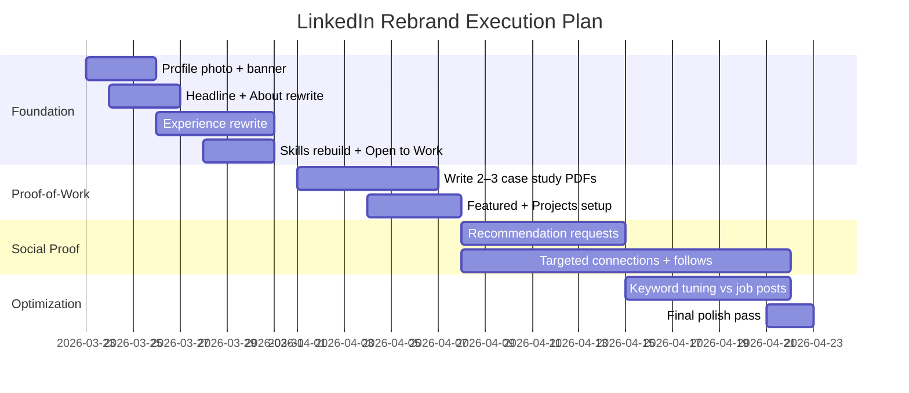

# LinkedIn Profile Rebrand and Rewrite Report for Yousef Fayyaz

## Executive summary

Your profile has enough real, quantified engineering impact to compete for strong roles. The problem is packaging: the first-screen story (headline + About + Featured) is currently signaling “student” and “generalist,” which is a conversion killer for recruiter searches and quick scans. The fact sheet explicitly warns against leading with student framing and instead positions you as an experienced engineer finishing final MSc requirements. fileciteturn3file0

The rebrand that will perform best is a single, recruiter-friendly spine: **“Data Engineer (core) + Applied AI (edge/ML) + Platform/MLOps (Kubernetes/IAM)”**—with **Data Engineer / Analytics Engineer** as the default “search hook” and ML/Platform as credibility multipliers. This matches how profiles get found (keywords across headline, skills, and experience) and how recruiters filter for qualified people at scale. citeturn12view0turn11search2turn8search1turn13view0

What you’ll deliver in 30 days:
- A keyword-rich, outcomes-first profile with **credible metrics** (5 TB migration; 4h→55m reporting; 86% precision churn model; 640 accounts retained; +28% forecasting accuracy; +45% team output). fileciteturn3file0  
- A Featured section that **converts clicks into interviews** via tight case studies + GitHub proofs (even though Featured content itself isn’t searchable). citeturn3search2turn3search0  
- A skills architecture that aligns to how recruiters and LinkedIn matching operate (up to 100 skills; completeness → higher discoverability). citeturn8search1turn11search2turn12view0

## Critical analysis

You have a positioning contradiction: **your strongest signal is “experienced engineer,”** but the public snippet strongly suggests you’re leading with “MSc student.” The snippet visible from public search shows wording like “I’m a Data Engineer and … MSc student …” and then trails off into generic responsibilities. citeturn1search0 This is exactly the framing your own fact sheet flags as harmful for industry hiring. fileciteturn3file0

Your biggest underestimated risks:
- **Unfocused target identity**: “Data Engineer + AI Engineer + Cloud Engineer + Research Engineer” can read as “unclear,” not “versatile.” Recruiters filter fast; people who look like they want everything often get nothing. LinkedIn’s own guidance pushes a clear headline + summary and relevant experiences aligned to current career goals. citeturn12view0
- **Proof-of-work is likely buried or missing**: without a tight Featured section and “outcomes-first” experience bullets, your strongest assets (quant metrics + GitHub projects) won’t be seen. Featured is designed to showcase work samples, but it’s not discoverable through search—so it must be placed to improve conversion once a recruiter clicks through. citeturn3search2turn3search0
- **Incomplete/weak data in one research role**: the March–June 2025 Research Assistant entry is explicitly under-specified (supervisor/lab/deliverables missing). Leaving vague roles is worse than omitting them, because it triggers “inflated profile” suspicion. fileciteturn3file0
- **Open-to-Work optics vs. effectiveness**: the feature helps you appear in recruiter searches, but public framing can create stigma in some contexts. LinkedIn also notes the Recruiters-only setting reduces exposure but can’t guarantee complete privacy. citeturn8search3turn8news46
- **Missing personal inputs (you must supply)**:
  - Preferred name (currently “VERIFY”). fileciteturn3file0
  - Willingness to relocate + which countries, and work authorization status in Italy/EU.
  - Portfolio website (currently “ADD_IF_AVAILABLE”). fileciteturn3file0
  - Target job titles (pick 3–5 max for Open to Work).
  - For RES-001: supervisor/lab/project name + concrete outputs. fileciteturn3file0
  - Whether you want your phone number visible (spam risk) vs email-only.

## Recruiter and ATS evidence base

LinkedIn’s own documentation makes the mechanism clear: **profile completeness increases discoverability and profile search appearances**, and the “All-star” profile rating is achieved by completing core fields (photo, location, industry, education, position, skills, summary). citeturn11search2turn12view0 That means your first priority is not “writing better,” it’s **ensuring the platform has the structured fields** recruiters filter on.

Visual credibility is not optional. LinkedIn states members with a profile photo receive up to **2X more profile views**, and provides explicit image specs (profile photo min 400×400; banner recommended 1584×396; JPG/PNG; max 8MB). citeturn12view0turn5view0 LinkedIn also enforces photo guidelines (no logos/flags/emoji-only images; must resemble you). citeturn6view0

Recruiter workflows are shifting toward **AI-supported discovery**, and that increases the penalty for vague or underspecified profiles. LinkedIn’s 2026 research reports recruiters plan to increase AI use and that AI is already helping them find candidates they wouldn’t have found via traditional filters. The same source also claims verified members receive materially higher profile engagement. citeturn13view0 The practical implication: **your structured keywords + verified credentials matter more**, not less.

Keyword reality-check from current job descriptions (samples used to extract common terms):
- Data engineering postings emphasize **SQL/Python, ETL/ELT, data pipelines, warehousing/lakes, data modeling, and quality/monitoring**, plus common stack terms like Spark/Airflow/dbt/BigQuery depending on company. citeturn15search3turn15search6turn15search2turn15search12
- Platform/cloud postings heavily weight **Kubernetes in production, IaC (Terraform/Pulumi), GitOps (ArgoCD), service mesh (Istio), CI/CD, security and reliability**. citeturn14search0turn14search1turn14search4turn14search9
- AI engineer postings increasingly highlight **LLM systems (RAG, evaluation, model serving), inference optimization, PyTorch/Transformers, and productionization (APIs, monitoring, MLOps)**. citeturn16search3turn16search7turn16search0turn16search11
- Business/finance/consulting postings prioritize **forecasting, KPI variance analysis, modeling, executive-ready storytelling**, and (for analyst roles) often SQL/BI. citeturn17search2turn17search8
- Marketing/sales postings prioritize **pipeline/meetings/quotas** (sales) and **demand gen + funnel metrics + experimentation** (marketing). citeturn18search0turn19search0turn19search4

This is why your profile must lead with the titles recruiters search (Data Engineer / Analytics Engineer / Applied AI Engineer / Platform Engineer), while your “hybrid” story lives in Experience, Projects, and Featured.

## Profile rewrite specification

### Current vs recommended comparison table

Because LinkedIn blocks unauthenticated profile viewing (your profile page returns an access error), only a **partial public snippet** was observable; most sections are therefore “not observable.” citeturn1search0

| LinkedIn section | Current (observable) | Recommended (what changes) |
|---|---|---|
| Profile photo | Not observable | High-trust headshot per LinkedIn specs + guidelines. citeturn5view0turn6view0turn12view0 |
| Background image | Not observable | Banner that reinforces your “Data/AI/Platform” spine; sized 1584×396. citeturn5view0turn7view0 |
| Headline | Mentions “Data Engineer” + “MSc student” (snippet) citeturn1search0 | Replace student-first with role/keywords-first; keep MSc note out of headline. fileciteturn3file0 |
| About/Summary | Starts “I’m a Data Engineer and … MSc student …” (snippet) citeturn1search0 | Outcomes-first summary with metrics + tool keywords; MSc appears once, late, if at all. fileciteturn3file0turn12view0 |
| Featured | Not observable | Add 4–6 proof assets; remember Featured isn’t searchable, it’s a conversion tool. citeturn3search2turn3search0 |
| Experience entries | Not observable | Rewrite each role into quantified outcomes + tooling + scope; de-risk vague research entry. fileciteturn3file0 |
| Education | Not observable | Keep education below experience; “thesis in progress” wording. fileciteturn3file0 |
| Licenses & Certifications | Not observable | Add only real/earned certs; otherwise keep clean + pursue selectively. fileciteturn3file0 |
| Skills & Endorsements | Not observable | Build to 50–80 relevant skills (max 100), pin top 3 aligned to target role. citeturn8search1turn12view0 |
| Recommendations | Not observable | Request 2–3 targeted recommendations tied to measurable outcomes. citeturn12view0 |
| Accomplishments (Projects/Languages/etc.) | Not observable | Add projects with metrics; add languages (English C2, Italian A2; verify Persian level). fileciteturn3file0turn11search0 |
| Volunteer | Not observable | Add only if it signals leadership/impact. |
| Interests | Not observable | Follow companies/skills aligned to target spine. |
| Contact info | Not observable | Email visible; phone optional; add GitHub + portfolio site once ready. fileciteturn3file0 |
| Open to Work | Not observable | Enable “Recruiters only” + tight set of titles/locations; avoid public banner unless needed. citeturn8search3turn8news46 |

### Section-by-section entries, keywords, formatting, and metrics

**Important constraint note:** LinkedIn field limits vary by field and can change. LinkedIn explicitly states the headline limit is **220 characters**. citeturn4search4 For other fields, LinkedIn often shows an in-product counter; use it as final validation. (All draft text below is written to be comfortably within typical limits and to keep the “above the fold” lines strong.)

#### Profile photo
- **Exact “entry”**: N/A (image)
- **Specs**: upload JPG/PNG; max 8MB; size between 400×400 and 7680×4320; avoid heavy cropping. citeturn5view0
- **Content rules**: must resemble you; no logos/emoji-only/flags, etc. citeturn6view0
- **Formatting**: emojis **No**
- **Measurable “proof” concept**: none; this is trust + recognition.
- **Keywords**: none (photo does not index; it converts).

#### Background image
- **Specs**: recommended 1584×396. citeturn5view0
- **Purpose**: “professional billboard” that supports your story; LinkedIn suggests aligning it to personality, milestones, or values. citeturn7view0
- **Exact overlay text option A (minimal, recruiter-friendly)**:
```text
DATA ENGINEERING • APPLIED AI • PLATFORM / MLOPS
Python • SQL • ETL/ELT • Warehousing • Kubernetes • IAM
Turin, Italy | EU • Remote
```
- **Exact overlay text option B (case-study angle)**:
```text
5 TB warehouse migration | 4h → 55m reporting
Churn model: 86% precision | Retained 640 accounts
Kubernetes IAM: Keycloak • OAuth2 • Istio • Kubeflow
```
- **Formatting**: emojis **No** (clean, enterprise-safe)

image_group{"layout":"carousel","aspect_ratio":"16:9","query":["minimal LinkedIn banner data engineer dark gradient","LinkedIn banner Kubernetes cloud platform engineer minimalist","LinkedIn banner machine learning engineer clean typography","LinkedIn banner data pipeline abstract lines"],"num_per_query":1}

#### Headline
- **Formatting**: use separators `|` or `•`; emojis **No**
- **Keyword rule**: headline is a hard search field—front-load role title + top tools. citeturn4search4turn12view0
- **Tech/Product/Engineering headlines (pick one as active; keep others saved)**:
```text
Option T1: Data Engineer (5+ yrs) | Python, SQL | ETL/ELT, Data Warehousing, Forecasting | GCP BigQuery/Dataform | Open to EU/Remote
Option T2: Applied AI Engineer / ML Engineer | PyTorch, Transformers | NLP + Multimodal | Experimentation & Evaluation | Data Engineering (SQL, ETL) | EU/Remote
Option T3: Platform / Cloud Engineer (Kubernetes) | IAM/SSO (Keycloak, OAuth2) | Istio, Kubeflow | Automation & Secure Multi-Tenant Platforms | EU
```
- **Business/Finance/Consulting headlines (only if you’re truly pivoting)**:
```text
Option B1: Data & Finance Analytics | SQL, Forecasting | KPI Reporting, Dashboards | Process Automation (Python) | FP&A / Ops Analytics
Option B2: Business Analyst | SQL + BI | Data Warehousing & Reporting | Forecasting | Cross-functional stakeholder support
Option B3: Analytics Consultant | Data Modeling, SQL | Metrics & Executive Reporting | Process Improvement | Open to EU/Remote
```
- **Marketing/Sales headlines (high-risk pivot; your proof base is weaker here)**:
```text
Option M1: Growth & Demand Gen Analytics | Funnel Metrics, Attribution, A/B Testing | Dashboards (BI/SQL) | Marketing Ops Automation
Option M2: Product Marketing Analytics | Technical storytelling + data | Developer marketing support | KPI tracking & insights
Option M3: Revenue Ops / Sales Ops Analytics | Pipeline metrics, reporting automation | CRM data workflows | SQL + dashboards
```
- **Suggested headline keywords (Tech)**: Data Engineer, Analytics Engineer, ETL, ELT, data pipelines, data warehouse, SQL, Python, BigQuery, dbt/Dataform, CDC/Datastream, Spark, Power BI, Kubernetes, IAM, Keycloak, OAuth2, Istio, Kubeflow. citeturn15search3turn15search2turn14search0turn14search1

#### About/Summary
- **Formatting**: bullets **Yes** (tight set); emojis **No**
- **Tone**: first person; 1–2 short paragraphs + bullets is consistent with LinkedIn guidance. citeturn12view0  
- **Tech/Product/Engineering About summaries (3 options)**:

```text
Option T-About-1 (Data Engineering spine)
Data Engineer and Applied AI Engineer with 5+ years building analytics-ready data products and ML-driven insights—from on-prem MS SQL Server warehousing to Python/SQL pipelines and cloud-backed research infrastructure.

Selected outcomes:
• Migrated 5 TB from fragmented MS SQL Server instances into a centralized warehouse, cutting report generation time from 4h to 55m.
• Built a Random Forest churn model (86% precision) that supported retention of 640 accounts.
• Improved forecasting pipeline accuracy by 28% and optimized DB performance to free 30% server storage.
• Mentored 4 junior data staff, contributing to a 45% increase in team output.

Current focus: scalable data pipelines, ML experimentation + evaluation, and secure multi-tenant platforms (Kubernetes, Keycloak/Dex, OAuth2 Proxy, Istio, Kubeflow).

Based in Turin, Italy. Open to Data Engineer / Analytics Engineer / Applied AI roles across Italy/EU and remote-friendly teams.
```

```text
Option T-About-2 (Applied AI spine)
Applied AI Engineer with 5+ years across ML experimentation, embedded/edge deployment, and the data engineering foundations that make models usable.

Highlights:
• Built a Random Forest churn model (86% precision) supporting retention of 640 accounts.
• Built simulation-first evaluation workflows (40+ operating conditions) for embedded robotics on NVIDIA Jetson Xavier.
• Built multimodal and NLP research pipelines in Python (PyTorch/Transformers) with reproducible training, evaluation, and reporting artifacts.

I like roles where “the model” is only half the problem: data quality, evaluation design, deployment constraints, and reliable pipelines matter just as much.

Based in Turin, Italy. Open to Applied AI / ML Engineer / Research Engineer roles in Italy/EU or remote-friendly teams.
```

```text
Option T-About-3 (Platform/MLOps spine)
Cloud & MLOps-leaning engineer with 5+ years across data systems and research infrastructure—experienced building secure platforms that support ML workflows.

Recent platform work:
• Designed centralized authentication gateway (Keycloak + Dex + OAuth2 Proxy) enabling SSO + 2FA.
• Implemented Kubernetes RBAC for multi-tenant isolation across departments and services.
• Configured Istio traffic policies and supported Kubeflow-based ML workflows.

Earlier in industry, I built and migrated analytics platforms (5 TB warehouse migration; reporting time 4h → 55m) and shipped predictive models (86% precision churn model).

Based in Turin, Italy. Open to Platform / Cloud / MLOps roles across EU and remote-friendly teams.
```

- **Business/Finance/Consulting About summaries (3 options)**:

```text
Option B-About-1 (FP&A / Ops Analytics angle)
I build reliable reporting and forecasting foundations for business decisions. Over 5+ years, I’ve owned data pipelines, warehousing, KPI dashboards, and predictive analyses that turned messy operational data into actionable metrics.

Selected outcomes:
• Migrated 5 TB into a centralized warehouse, reducing recurring reporting from 4h to 55m.
• Improved forecasting accuracy by 28% and implemented validation to reduce reporting errors.
• Built churn prediction (86% precision) that supported retention of 640 accounts.

Based in Turin, Italy. Open to Business Analyst / FP&A Analytics / Operations Analytics roles in Italy/EU or remote-friendly teams.
```

```text
Option B-About-2 (Consulting/BI delivery angle)
Analytical engineer with 5+ years delivering measurable outcomes in reporting, forecasting, and data system modernization. I’m effective in ambiguous environments where stakeholders need clarity, not dashboard clutter.

Representative results include a 5 TB warehouse consolidation (4h → 55m reporting) and a +28% forecasting accuracy improvement.

Based in Turin, Italy. Open to analytics consulting / BI / operations analytics roles across Italy/EU or remote-friendly teams.
```

```text
Option B-About-3 (Business Analyst angle)
Business/data analyst profile anchored in engineering rigor: I build the data foundations, then translate metrics into decisions. Experience includes warehousing, KPI dashboards, forecasting, and predictive analytics.

Tools: SQL, Python, Power BI, data modeling, ETL/ELT.
Based in Turin, Italy; open to Business Analyst / BI Analyst / Analytics Engineer roles.
```

- **Marketing/Sales About summaries (3 options)**:

```text
Option M-About-1 (Growth analytics angle)
Data-driven growth profile built on engineering fundamentals: I’m strongest when marketing/sales teams need trustworthy funnel metrics, attribution-ready datasets, and automated reporting.

Relevant outcomes:
• Built churn prediction (86% precision) supporting retention of 640 accounts.
• Centralized 5 TB of data into a warehouse, cutting recurring reporting from 4h to 55m.
• Delivered forecasting improvements (+28% accuracy) and operational dashboards.

Based in Turin, Italy. Open to Growth Analytics / RevOps Analytics / Marketing Ops Analytics roles (EU/remote).
```

```text
Option M-About-2 (Product marketing analytics angle)
I bridge technical products and measurable adoption: turning usage data into narratives, dashboards, and experiments that clarify what’s working and why.

Background: data engineering + applied ML (Python/SQL), reporting systems, and experimentation-oriented projects (NLP, multimodal).

Turin-based; open to Product Marketing Analytics / Developer Marketing Analytics / GTM Analytics roles.
```

```text
Option M-About-3 (Sales ops analytics angle)
I build sales/ops analytics systems that reduce noise and increase decision speed: clean datasets, reliable dashboards, and predictive signals that help teams prioritize.

Examples: churn model (86% precision), reporting acceleration via warehouse consolidation (4h → 55m), forecasting improvement (+28% accuracy).
Based in Turin, Italy; open to Sales Ops Analytics / Revenue Ops Analytics / BizOps roles.
```

- **Suggested About keywords (Tech)**: data pipelines, ETL/ELT, data warehouse, SQL, Python, Power BI, forecasting, data validation/quality, Kubernetes, Keycloak, OAuth2, Istio, Kubeflow, PyTorch, Transformers, NLP, multimodal, evaluation, inference pipelines. citeturn15search6turn14search0turn16search3turn16search7  
- **Measurable statements**: already embedded; do not add new metrics unless you can defend them. fileciteturn3file0

#### Featured
- **Function**: showcase work samples; you can feature posts/articles/external media; Featured content is not discoverable via search and requires viewers to be logged in. citeturn3search2  
- **Access caveat**: LinkedIn Help indicates some “pinning profile content” functionality may be limited to certain Premium tiers. Treat this as feature variability and test on your account. citeturn3search0  
- **Formatting**: emojis **No**
- **Suggested media set (filenames + exact captions)**:
  1) **Document** — `CaseStudy_DataWarehouse_Migration_5TB.pdf`  
     Caption:
     ```text
     Case study: 5 TB warehouse consolidation (MS SQL Server) — reduced report generation from 4h to 55m; improved performance and data reliability.
     ```
  2) **Document** — `CaseStudy_ChurnModel_RandomForest.pdf`  
     Caption:
     ```text
     Case study: churn prediction (Random Forest) — 86% precision; supported retention initiatives affecting 640 accounts.
     ```
  3) **Document** — `CaseStudy_ResearchPlatform_IAM_Kubernetes.pdf`  
     Caption:
     ```text
     Platform architecture: Keycloak + Dex + OAuth2 Proxy + Kubernetes RBAC — enabled SSO/2FA and multi-tenant isolation; supported Kubeflow workflows.
     ```
  4) **Link** — GitHub repo: Wildfire project  
     Title:
     ```text
     Multimodal Wildfire Burned Area Prediction (PyTorch)
     ```
     Caption:
     ```text
     Research prototype: baseline vs multimodal segmentation; IoU 0.1515 → 0.4026 and F1 0.2632 → 0.5741 in repo comparisons.
     ```
  5) **Link** — GitHub repo: Sarcasm detection  
     Title:
     ```text
     NLP Experimentation: Sarcasm Detection (Transformers + QLoRA)
     ```
     Caption:
     ```text
     Config-first training/eval framework across model families; robustness analysis across English varieties and sources.
     ```
  6) **Link** — GitHub repo: RL Hopper  
     Title:
     ```text
     Reinforcement Learning: Custom MuJoCo Hopper (Domain Randomization)
     ```
     Caption:
     ```text
     Reproducible RL experimentation framework; PPO variants with robustness strategies and evaluation utilities.
     ```
- **Keywords to include in Featured titles**: case study, data warehouse, ETL, churn prediction, Kubernetes, IAM, Keycloak, ML, NLP, multimodal.  
- **Add/remove instructions (desktop)**: LinkedIn documents the “Me → View Profile → Featured → Add” workflow. citeturn3search0turn11search0

image_group{"layout":"carousel","aspect_ratio":"16:9","query":["one page case study PDF cover design data engineering","portfolio case study layout reporting time reduction","architecture diagram Kubernetes SSO Keycloak OAuth2 Istio","GitHub README screenshot machine learning project"],"num_per_query":1}

#### Experience entries
- **Formatting**: bullets **Yes**; emojis **No**; 4–6 bullets per role max.
- **Rule**: Every role must include (a) scope, (b) tools, (c) quantified outcomes. LinkedIn explicitly recommends adding relevant work aligned to career goals and adding media samples for portfolio quick access. citeturn12view0

**Experience: Data Engineer — TGAT (Iran)**
```text
Owned end-to-end data workflows across ETL/ELT, warehousing, reporting, and predictive analytics for customer and operational use cases.

• Migrated 5 TB from multiple standalone MS SQL Server instances into a centralized on‑prem data warehouse, cutting report generation time from 4 hours to 55 minutes.
• Built a Random Forest churn‑prediction model (86% precision) that supported retention initiatives affecting 640 accounts.
• Designed and maintained SQL + Python ETL/ELT pipelines with validation checks to deliver analytics‑ready datasets for reporting and forecasting.
• Built an internal BI web application in Python when off‑the‑shelf tools couldn’t meet real‑time reporting requirements.
• Optimized indexing, archiving, and partitioning strategies to free 30% of server storage and delay hardware upgrades.
• Mentored 4 junior data staff; contributed to a ~45% increase in team output through standards, reviews, and training.
```
- **Keywords**: SQL, Python, ETL, ELT, data warehouse, MS SQL Server, Power BI, forecasting, churn prediction, data validation, performance tuning. fileciteturn3file0turn15search3
- **Suggested metrics to add if verifiable** (do not invent): number of sources integrated; dashboard user count; refresh cadence; annual license € saved; pipeline SLA/uptime; failure rate reduction.

**Experience: Embedded AI Engineer — TGAT (Iran)**
```text
Built and deployed embedded robotics / edge‑AI systems, balancing sensor integration, simulation-driven evaluation, and hardware constraints.

• Deployed robotic systems on NVIDIA Jetson Xavier; integrated IMU, GNSS, and camera streams for real‑time spatial awareness.
• Built Python simulation workflows to evaluate AI behavior across 40+ operating conditions before field testing.
• Prototyped reinforcement‑learning approaches to improve system adaptability in changing environments.
• Diagnosed bottlenecks and optimized CPU/GPU memory usage to maintain stable continuous operation during live evaluations.
```
- **Keywords**: edge AI, embedded AI, simulation, reinforcement learning, sensor fusion, Python. fileciteturn3file0
- **Suggested metrics to add if verifiable**: inference latency (ms), FPS, uptime during field tests (hours), failure rate before vs after simulation gate.

**Experience: Graduate Research Assistant, Cloud and MLOps — Politecnico di Torino (Turin, Italy)**
```text
Graduate Research Assistant (Cloud & MLOps) focused on secure multi-tenant infrastructure and ML workflow support in a research platform.

• Architected a centralized authentication gateway integrating Keycloak, Dex, and OAuth2 Proxy; enforced SSO and 2FA across platform services.
• Implemented Kubernetes RBAC and group-based access controls to isolate resources across departments (multi-tenant).
• Configured Istio traffic-management policies and supported Kubeflow-based ML workflow execution.
```
- **Keywords**: Kubernetes, RBAC, IAM, Keycloak, OAuth2, SSO, 2FA, Istio, Kubeflow, MLOps. fileciteturn3file0turn14search0
- **Suggested metrics to add if verifiable**: number of tenants/namespaces; number of services protected; number of users/departments onboarded; incident reduction; time-to-onboard.

**Experience: Research Assistant (Embedded Systems UROP) — Politecnico di Torino (Turin, Italy)**
```text
Research Assistant (Embedded Systems UROP)

• Supported Python-based experimentation and prototyping in an embedded-systems research context.
```
- **Keywords**: embedded systems, Python, research.
- **Critical requirement**: add supervisor/lab/project name and 1–2 concrete deliverables once confirmed. fileciteturn3file0

**Experience: Teaching Assistant — Politecnico di Torino (Turin, Italy)**
Given this is a 40-hour appointment, include it only if you make scope explicit so recruiters don’t assume an ongoing major commitment. fileciteturn3file0  
```text
Teaching Assistant (40-hour appointment)

• Supported lab sessions and student debugging in embedded systems; clarified concepts and reviewed assignments.
```
- **Keywords**: mentoring, technical communication, embedded systems.
- **Suggested metrics to add if verifiable**: cohort size; number of sessions; office hours.

#### Education
- **Formatting**: bullets **Optional**; emojis **No**
- **Placement**: keep below experience for industry roles (your fact sheet is explicit). fileciteturn3file0

**MSc**
```text
MSc, Data Science and Engineering — Politecnico di Torino (in progress)
Focus: data engineering, applied ML, and research infrastructure. Thesis in progress.
```

**BSc**
```text
BSc, Computer Engineering — Azad University (Tehran Branch)
```

- **Keywords**: Data Science and Engineering, Computer Engineering, applied ML, data engineering.  
- **Suggested metrics**: thesis topic (once locked); relevant courses (top 4–6 only).

#### Licenses & Certifications
- **Formatting**: emojis **No**
- **Policy**: your fact sheet recommends using certs on LinkedIn selectively, not stuffing the resume. fileciteturn3file0
- **Exact entries (choose only if earned; otherwise mark as “in progress” only if true)**:
```text
Google Cloud Professional Data Engineer — (Issuing org: Google Cloud)
AWS Certified Data Engineer – Associate — (Issuing org: Amazon Web Services)
CKA: Certified Kubernetes Administrator — (Issuing org: CNCF)
```
- **Keywords**: BigQuery, cloud data, Kubernetes, IaC.

#### Skills & Endorsements
- **Max count**: up to 100 skills. citeturn8search1  
- **Formatting**: emojis **No**
- **Pinned top 3 (default for Tech spine)**:
```text
Data Engineering
Python
SQL
```
- **High-priority skills list (add 50–80; sample set below)**:
```text
ETL, ELT, Data Pipelines, Data Warehousing, Data Modeling, Data Quality, Data Validation,
MS SQL Server, PostgreSQL, Power BI, Power Query, Forecasting, Time Series Analysis,
Apache Spark, PySpark, Redis,
Google BigQuery, Dataform, Datastream, Change Data Capture (CDC),
Amazon S3, Amazon Redshift, AWS Lambda (basic),
Kubernetes, Docker, Istio, Kubeflow,
Keycloak, Dex, OAuth2 Proxy, SSO, RBAC, IAM,
Machine Learning, Predictive Modeling, Random Forest,
PyTorch, Transformers, NLP, Multimodal Learning, Reinforcement Learning,
Experiment Design, Model Evaluation, Error Analysis,
Git, GitHub, CI/CD (basic),
Technical Documentation, Mentoring, Stakeholder Communication
```
- **Why this matters**: LinkedIn explicitly states relevant skills help others match you with opportunities and increase discovery likelihood via endorsements. citeturn12view0turn8search1  
- **Keyword alignment evidence**: these terms map directly onto current Data Engineer / Platform Engineer / AI Engineer job descriptions (SQL/Python/warehousing; Kubernetes/IaC; LLM/ML systems). citeturn15search3turn14search0turn16search3

#### Recommendations
- **Formatting**: emojis **No**
- **Goal**: 1 recommendation per “pillar”: (1) Data Engineering manager/peer, (2) AI/embedded peer, (3) Research supervisor. LinkedIn recommends requesting recommendations; no limit. citeturn12view0  
- **Exact recommendation request message (copy/paste)**:
```text
Hi [Name] — I’m updating my LinkedIn and would value a short recommendation focused on the impact I delivered on [project/workstream]. 

If helpful, here are 2–3 points you could reference:
• [Outcome + metric, e.g., “5 TB warehouse migration; reporting 4h → 55m”]
• [Outcome + metric, e.g., “churn model 86% precision; supported retention of 640 accounts”]
• [Working style, e.g., “reliable execution, clear communication, mentoring”]

Totally fine if now isn’t a good time. Thank you.
```

#### Accomplishments
- **Publications**: unspecified (do not add unless real).
- **Projects (add 3–5 max; with metrics)**:  
  Use LinkedIn’s “Projects” section; note LinkedIn warns that the Project URL field may not be available for newly-added projects and suggests adding links via “Add media.” citeturn11search0

**Exact project entries (descriptions)**
```text
Multimodal Wildfire Burned Area Prediction (PyTorch)
Built a multimodal deep-learning framework for burned-area prediction from pre-fire data. Improved best-threshold IoU from 0.1515 to 0.4026 and F1 from 0.2632 to 0.5741 versus a Sentinel-only baseline.

Sarcasm Detection NLP (Transformers + QLoRA)
Built a config-first NLP experimentation pipeline for sarcasm/sentiment classification with grouped robustness analysis across English varieties and sources (17,760 train / 2,428 validation samples).

Reinforcement Learning for Custom MuJoCo Hopper
Built an RL experimentation framework comparing REINFORCE, Actor-Critic, and PPO; added domain randomization strategies and evaluation utilities for robustness analysis.
```
- **Courses**: unspecified (add only high-signal courses relevant to target roles).
- **Languages (exact entries)**:
```text
English — C2
Italian — A2
Persian/Farsi — [verify level]
```
- **Organizations/Patents/Honors**: unspecified.

#### Volunteer
- **Status**: unspecified.
- **Rule**: only add volunteer work if it signals leadership, engineering delivery, teaching, or social proof relevant to target roles.

#### Interests
- **Strategy**: follow target companies + communities aligned to your spine (data platforms, MLOps, Kubernetes, applied ML).
- **Do not** follow random topics that dilute your signal.

#### Contact info
- **Exact entries (based on fact sheet; adjust visibility)**: fileciteturn3file0  
```text
Primary email: yousef.f3@gmail.com
Secondary email: s341999@studenti.polito.it
Phone: +39 379 102 2373 (optional; consider limiting visibility)
GitHub: github.com/josephfayyaz
Portfolio: [add once available]
Location: Turin, Italy
```

#### Open to Work
- **Mechanism**: LinkedIn states adding job preferences helps your profile show up in recruiter searches; you can choose visibility (Recruiters only vs all members). citeturn8search3  
- **Privacy risk**: LinkedIn notes it can’t guarantee complete privacy even with Recruiters-only. citeturn8search3  
- **Optics trade-off**: some hiring markets still attach stigma to the public banner; Recruiters-only is typically the better executive choice unless you need maximum inbound. citeturn8news46turn8search3  
- **Exact Open to Work configuration (recommended default)**:
```text
Visibility: Recruiters only
Job titles (pick 3–5 max):
- Data Engineer
- Analytics Engineer
- Machine Learning Engineer (Applied)
- MLOps Engineer / Platform Engineer (if targeting)
Locations:
- Italy (on-site/hybrid)
- European Union (relocation/hybrid)
- Remote (Europe-friendly)
Start date: Immediately / Flexible
Employment types: Full-time (primary)
```

## Prioritized action plan

### Safari edit sequence you should apply

The point is speed + correctness: do this in one pass, top-to-bottom, so recruiters see a coherent story immediately.

1) **Open profile + confirm “All-star” basics are complete** (photo, location, industry, education, position, skills, summary). LinkedIn explicitly ties completeness to discoverability and the All-star rating. citeturn11search2  
2) **Replace Headline** with Tech Option T1 (or the option aligned to your primary target). Headline limit is 220 characters—use them for role + tools, not student status. citeturn4search4  
3) **Rewrite About** using Tech Option T-About-1 (data engineering spine). Keep the top 3 lines as a hook; use bullets for metrics, consistent with LinkedIn guidance. citeturn12view0  
4) **Update background banner** to the new 1584×396 image. citeturn5view0turn7view0  
5) **Rewrite Experience entries** (TGAT Data Engineer → TGAT Embedded AI → Research Platform role). Your metrics are a competitive advantage; they must be visible in the first skim. fileciteturn3file0  
6) **Either fix or minimize the vague research assistant role** (RES-001). If you can’t name the lab/supervisor/output, keep it to one conservative bullet. fileciteturn3file0  
7) **Build Featured** with the 4–6 proof assets. Use LinkedIn’s documented workflow (“Me → View Profile → Featured → Add”). citeturn3search0turn11search0  
8) **Rebuild Skills**: add 50–80 skills, pin top 3, delete anything irrelevant. Help page confirms up to 100 skills. citeturn8search1  
9) **Add Projects** (3 max) with metrics + links via media if needed. citeturn11search0  
10) **Set Open to Work → Recruiters only** and select 3–5 titles + locations. citeturn8search3  
11) **Request 2–3 recommendations** using the provided template. LinkedIn recommends requesting recommendations and notes no limit. citeturn12view0  
12) **Privacy cleanup**: decide whether your phone number should be visible; email should be reachable. Then sanity-check contact fields.

### 30-day implementation checklist

Week 1: core profile conversion
- Headline + About rewritten.
- Photo + banner updated to spec.
- Experience rewritten with metrics.
- Skills rebuilt (top 3 pinned).
- Open to Work set to Recruiters only. citeturn5view0turn8search3turn8search1turn4search4  

Week 2: proof assets + projects
- Publish 2–3 one-page case study PDFs (sanitized, no confidentials).
- Add Featured items + Projects with links via media.
- Add languages + any real certifications. citeturn3search2turn11search0  

Week 3: social proof + targeting
- Request recommendations (2–3).
- Follow target companies; connect with 10–15 relevant engineers/recruiters.
- Post 1 technical write-up or repo walkthrough (optional but helpful).

Week 4: iterate using outcomes
- Review recruiter searches/appearances (if available).
- Tighten keywords based on 10 target job descriptions.
- Remove low-signal content; expand only what you can defend.



### Recruiter outreach message template

LinkedIn notes InMail has a 200-character subject limit and 1900-character body limit; shorter messages tend to perform better. citeturn4search0

**Connection request note (short, non-needy)**
```text
Hi [Name] — I’m a Data Engineer (5+ yrs) in Turin with results in warehousing (5 TB migration; 4h→55m reporting) and applied ML (churn model 86% precision). Open to [role]. If you’re the right contact, happy to share a 1-page case study.
```

**InMail body (structured, recruiter-friendly)**
```text
Subject: Data Engineer — 5 TB warehouse + applied ML

Hi [Name] — I’m reaching out because I’m targeting Data Engineer / Analytics Engineer roles in Italy/EU (Turin-based, remote-friendly).

Snapshot:
• 5 TB warehouse consolidation (MS SQL Server) — reporting 4h → 55m
• Churn model (Random Forest) — 86% precision; supported retention of 640 accounts
• Platform/MLOps exposure — Kubernetes RBAC + IAM (Keycloak/Dex/OAuth2), Istio; Kubeflow support

If you’re hiring for [team/role], I can send a 1-page case study + portfolio links.  
Best,  
Yousef
```

**Final data you must confirm before you execute (non-negotiable)**
- Preferred name, relocation stance, and EU work authorization.
- Whether you want to be found for **Data Engineer** first (recommended) or to lead with ML/Platform instead.
- Portfolio website (if none, build a simple one-page Notion/GitHub Pages and link it).
- Details for the under-specified research assistant role (or keep it minimal). fileciteturn3file0